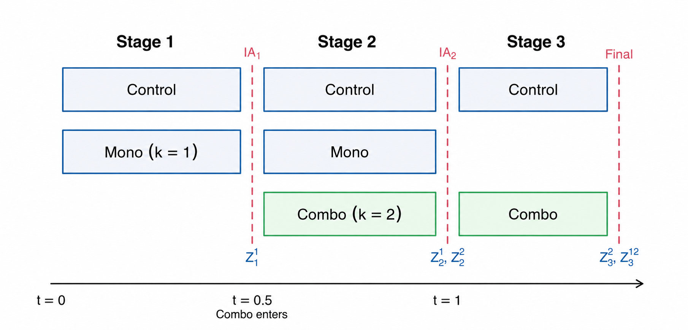
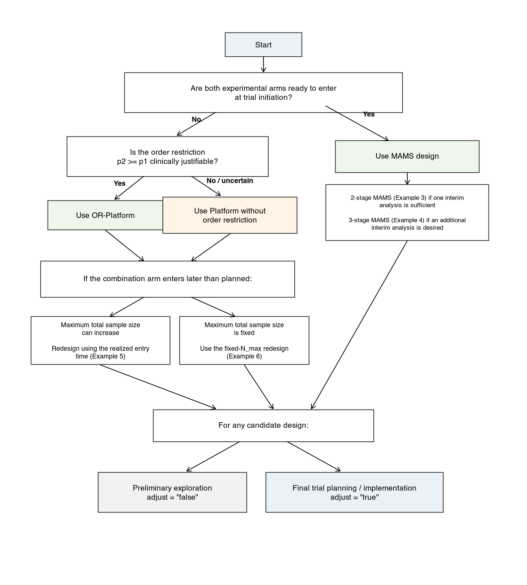

```{r setup, include=FALSE}
knitr::opts_chunk$set(echo = TRUE, warning = FALSE, message = FALSE,
                      eval = TRUE, collapse = TRUE, comment = "#>")
options(width = 110, digits = 4)
```

```{r load-package}
library(monocombo)
```

```{r table-helpers, include=FALSE}
platform_stage_table <- function(design, t = 0.5, t_arrive = t, N_max = FALSE) {
  n <- design$n1
  stage3_fraction <- if (N_max) 0.5 * (t + t_arrive) else t_arrive
  n_s1 <- round(n * t_arrive)
  n_s2 <- round(n * (1 - t_arrive))
  n_s3 <- round(n * stage3_fraction)

  data.frame(
    Stage = c("1", "2", "3"),
    Control = c(n_s1, n_s2, n_s3),
    `Arm A (monotherapy)` = c(n_s1, n_s2, NA),
    `Arm A+B (combination therapy)` = c(NA, n_s2, n_s3),
    ` ` = "",
    `Arm A boundary` = c(
      sprintf("(%.3f, %.3f)", design$l1, design$u11),
      sprintf("%.3f", design$u21),
      NA
    ),
    `Arm A+B boundary` = c(
      NA,
      sprintf("(%.3f, %.3f)", design$l1, design$u22),
      sprintf("%.3f", design$u32)
    ),
    check.names = FALSE
  )
}

mams_stage_table <- function(design, t) {
  cumulative <- round(design$n0 * t)
  increments <- c(cumulative[1], diff(cumulative))
  final_stage <- length(increments)
  boundary <- vapply(seq_along(increments), function(j) {
    upper <- design[[paste0("u", j)]]
    if (j == final_stage) sprintf("%.3f", upper)
    else sprintf("(%.3f, %.3f)", design[[paste0("l", j)]], upper)
  }, character(1))

  data.frame(
    Stage = as.character(seq_along(increments)),
    Control = increments,
    `Arm A (monotherapy)` = increments,
    `Arm A+B (combination therapy)` = increments,
    ` ` = "",
    `Arm A boundary` = boundary,
    `Arm A+B boundary` = boundary,
    check.names = FALSE
  )
}

display_stage_table <- function(x, caption) {
  old_kable_na <- options(knitr.kable.NA = "--")
  on.exit(options(old_kable_na), add = TRUE)
  knitr::kable(
    x,
    caption = caption,
    align = c("c", "c", "c", "c", "c", "c", "c"),
    digits = 3
  ) |>
    kableExtra::add_header_above(
      c(" " = 1, "Sample size (n)" = 3, "  " = 1, "Critical value (l, u)" = 2)
    )
}
```

# Background

## Clinical motivation

In many phase II monotherapy--combination development programs, the monotherapy is ready for clinical evaluation before the combination arm is ready to enter the trial. The delay in combination-arm readiness may arise from additional safety evaluation, drug supply or manufacturing constraints, dose-selection work, or other operational considerations. Investigators then face an inefficient choice: wait to initiate the trial until both experimental arms are ready to enter, or evaluate the monotherapy and combination in separate trials, requiring separate control groups and potentially prolonging development. Rolling and two-period platform designs provide an alternative by allowing a trial to begin with the experimental arms that are ready to enter and adding new experimental arms later while sharing control information across periods (Pan et al., 2022; Greenstreet et al., 2025). The present monotherapy--combination setting introduces an additional structure: when clinically justified, the combination may be expected to be at least as efficacious as monotherapy. This efficacy ordering information can be incorporated into the statistical design to improve efficiency and reduce the sample size required to achieve targeted power. The OR-Platform is a design proposed specifically for this setting, combining staggered combination-arm entry, shared concurrent controls, and order-restricted inference within a unified multi-stage framework (Zhang et al., submitted).

## Package overview

The `monocombo` package provides an end-to-end workflow for designing, evaluating, and conducting monotherapy--combination trials with binary endpoints. Its primary implementation is the OR-Platform design, which allows the monotherapy arm to begin enrollment before the combination arm is ready to enter the trial and incorporates clinically justified order information on response rate through order-restricted inference.

The package is organized around three main functions. `mc_Design()` determines the sample sizes and stage-specific efficacy boundaries from user-specified design inputs; `mc_OC()` evaluates operating characteristics, including family-wise error rate (FWER), power, early stopping probabilities, and expected sample size; and `mc_Analyze()` applies the decision rules from the selected OR-Platform design to observed stage-wise data during the trial to make interim and final decisions. Together, these functions provide a design-to-analysis workflow from initial planning through interim and final decision making.

In addition to the OR-Platform, `mc_Design()` and `mc_OC()` support three comparator designs: a rolling Platform design without an order restriction, a 2-stage multi-arm multi-stage (MAMS) design, and a 3-stage MAMS design. These alternatives are included to help quantify the efficiency gained from order restriction and to contrast rolling arm entry with conventional concurrent-entry multi-arm designs. Design calculations are based on an asymptotic multivariate-normal (MVN) approximation to the joint distribution of test statistics, with optional finite-sample simulation calibration to improve FWER control under specific assumptions of the underlying treatment response rates.

## When to use the OR-Platform

**The OR-Platform is particularly attractive when:**

- A new experimental regimen (e.g., A+B) may be ready to enter only after the trial has already started.
- The later regimen has a clinically defensible ordering relationship in terms of response rates with the earlier regimen.
- There will be savings of resources by adding the new regimen **without restarting the trial or launching a separate control group**.
- Efficient early stopping with strong one-sided FWER control across regimens under appropriate conditions is important.
- Inference should rely primarily on **concurrent randomized controls** rather than nonconcurrent or historical borrowing.

# Design Overview

The OR-Platform is the primary design implemented in `monocombo` for settings in which monotherapy can begin evaluation before the corresponding combination arm is ready to enter the trial. The trial initially randomizes patients between control and monotherapy arms; once the combination arm is ready to enter, it is added to the ongoing trial, resulting in a three-arm, three-stage rolling platform. The design exploits the clinically motivated order restriction $p_{2} \geq p_{1}$, where $p_{1}$ and $p_{2}$ denote the response probabilities for monotherapy and combination therapy, respectively, while basing treatment comparisons on concurrent control data. Stagewise decisions are made using prespecified test statistics and stopping boundaries, with the design jointly calibrated to provide efficient early decision-making while maintaining strong one-sided FWER control. The remainder of this section defines the trial structure and hypotheses, describes the stagewise decision rules, and summarizes the design calibration procedure. Full mathematical derivations are provided in the accompanying manuscript. Throughout the vignette, the accompanying manuscript refers to Zhang et al. (submitted).

## Trial setting

The primary endpoint is a binary efficacy response. The trial evaluates monotherapy A and combination A+B against a shared control arm, which may be placebo, standard care, or an active comparator. We use $k$ to index the two experimental treatment arms, with $k = 1$ denoting monotherapy A and $k = 2$ denoting combination A+B. Their response probabilities are denoted by $p_{1}$ and $p_{2}$, respectively, and the control response probability by $p_{0}$. Each treatment comparison uses only control patients enrolled concurrently with that experimental arm. When the clinically motivated ordering assumption $p_{2} \geq p_{1}$ is defensible, the OR-Platform incorporates this order restriction into its three-arm, three-stage decision rules.

The trial begins in Stage 1 with monotherapy A and control. Combination A+B is planned to enter after the Stage-1 interim analysis, conducted when a prespecified fraction $t \in (0,1)$ of the planned monotherapy sample size has accrued (default $t = 0.5$); the realized entry fraction is denoted by $t_{\mathrm{arrive}}$. If A crosses its early efficacy boundary at Stage 1, the trial stops and the combination arm is not activated. If A crosses its futility boundary, A is dropped, but A+B may still enter and be evaluated against its concurrent controls. If the realized combination-entry fraction differs from the planned value, `monocombo` provides prespecified procedures either to update the design using $t_{\mathrm{arrive}}$ or to calibrate the decision boundaries while preserving the planned maximum total sample size. Figure 1 summarizes the planned-entry trial structure and analysis timing.

```{r workflow-fig, echo=FALSE, out.width="100%"}

```

*Figure 1. Schematic of the three-arm, three-stage rolling OR-Platform design. Monotherapy $A$ ($k=1$) and the shared control begin enrollment in Stage 1, and combination $A+B$ ($k=2$) enters after the first interim analysis at the planned entry fraction $t=0.5$. $Z_1^1$ and $Z_2^1$ denote the Stage-1 and cumulative Stage-2 statistics comparing monotherapy with control; $Z_2^2$ and $Z_3^2$ denote the combination arm's first-look and cumulative final-stage statistics. $Z_3^{12}$ denotes the isotonic statistic used at the final analysis and jointly uses evidence from the monotherapy and combination comparisons with their concurrent controls under the order restriction $p_2 \geq p_1$. $IA_1$ and $IA_2$ denote the first and second interim analyses, respectively.*

## Hypotheses

Within this 3-arm rolling structure, the package tests two one-sided null hypotheses,

$$H_{01}:p_{1} \leq p_{0}\quad\quad\text{and}\quad\quad H_{02}:p_{2} \leq p_{0},$$

against the corresponding alternatives $H_{11}:p_{1} > p_{0}$ and $H_{12}:p_{2} > p_{0}$. The intersection, or global, null hypothesis is

$$H_{G} = H_{01} \cap H_{02} = \{p_{1} \leq p_{0},\ p_{2} \leq p_{0}\}.$$

For the initial critical-value calculation, the boundary of the global null $p_{0} = p_{1} = p_{2}$ plays a central role.

The MVN-based procedure is constructed to provide strong control of the FWER at level $\alpha$; a proof of the asymptotic strong control under appropriate conditions is provided in the accompanying manuscript.

## Stage-wise test statistics and decisions

To test the above hypotheses, a Wald-type $Z$-statistic $Z_{j}^{k}$ is computed at each interim or final analysis comparing experimental arm $k$ with control at stage $j$, using cumulative data from arm $k$ and its concurrent control. $Z_{j}^{k}$ is then compared with the corresponding stage- and arm-specific efficacy boundary $u_{j}^{k}$, $k = 1,2,\ j = 1,2,3,$ to make the corresponding stage-wise treatment decision. A common first-look futility boundary $l_{1}$ is applied at Stage 1 for monotherapy and Stage 2 for the combination arm; its default value is 0. Crossing this boundary drops monotherapy at Stage 1. For the combination arm, a first-look futility result ends its evaluation unless monotherapy crossed the Stage-2 efficacy boundary, in which case the Stage-3 isotonic decision path may still apply.

In the OR-Platform design, the clinically motivated order restriction $p_{2} \geq p_{1}$ may additionally be used at the final analysis. Specifically, when the monotherapy crosses the efficacy boundary at stage 2 and the combination therapy fails to cross the stage-specific efficacy boundaries at both stages 2 and 3, the isotonic statistic $Z_{3}^{12}$ is used to resolve the "contradictory" evidence from monotherapy and combination therapy under the order restriction. Here, the superscript $12$ indicates that the statistic uses information from both experimental arms 1 and 2. The definition of $Z_{3}^{12}$, together with its joint correlation structure with the other test statistics, is provided in the accompanying manuscript.

Worked examples illustrating the OR-Platform decisions at Stages 1, 2, and 3 are provided in Examples 9--11.

## Critical values and sample-size calculation

The initial critical value is calculated by root-finding using the design-specific MVN approximation to the joint distribution of the stage-wise test statistics under the boundary of the global null. This calculation is performed under the boundary of the global null so that the probability of rejecting at least one null hypothesis equals the one-sided level $\alpha$. The accompanying manuscript establishes that this calculation yields asymptotic strong FWER control under appropriate conditions. The sample size is then calculated under the specified alternative to attain the prespecified target disjunctive power---that is, the probability of rejecting at least one false null hypothesis---under the specified design alternative.

The true response probabilities are not assumed to be known during trial analysis. At the design stage, plausible values of $p_0$, $p_1$, and $p_2$ are specified as planning assumptions to determine sample size and evaluate power. Under the initial MVN calculation, the standardized global-null distribution and its critical value do not depend on the numerical values of $p_0$, $p_1$, or $p_2$, or on the absolute sample size, for fixed information fractions and boundary spending.

For all four design types, `adjust = "true"` adds finite-sample simulation after the initial MVN calculation. The critical value is calibrated under the global null at the specified working (planning) value $p_0^*$ and at the candidate sample size; $p_1$ and $p_2$ determine the design alternative and power and can affect the calibrated design indirectly through the selected sample size. This option is recommended when finalizing a design for implementation with binary outcomes because the MVN approximation may not provide sufficiently accurate finite-sample FWER control at small or moderate sample sizes. If prior information supports a plausible range rather than a reliable point estimate for $p_0$, investigators should generate separate candidate designs using several individually specified values of $p_0^*$. Each candidate design should then be held fixed and evaluated across the same plausible response-rate scenarios, including its FWER under global-null scenarios and its power under relevant alternatives. A design that maintains acceptable FWER and power across the prespecified scenarios should be selected. We therefore recommend `adjust = "true"` when finalizing an OR-Platform, Platform, or MAMS design for implementation. Use `adjust = "false"` for rapid preliminary exploration or when the unadjusted MVN design is specifically desired. During trial analysis, the true $p_0$ remains unknown and is estimated from concurrent randomized controls; none of the planning response rates is treated as known.

## Comparator designs

The package includes two comparison frameworks: a rolling Platform design without the order restriction and conventional MAMS designs. Comparing the OR-Platform with the Platform design isolates the statistical efficiency gain attributable to the order restriction, whereas comparing it with MAMS isolates the operational time advantage of rolling arm entry relative to simultaneous arm entry.

Statistical methods for adding new experimental arms to an ongoing multi-arm trial while sharing a common control have been developed, including the two-period framework of Pan et al. (2022). The Platform comparator implemented here is most directly aligned with the preplanned multi-stage framework of Greenstreet et al. (2025), adapted to the present binary-outcome setting. It retains the OR-Platform's 3-arm, 3-stage rolling structure: monotherapy begins with the shared control in Stage 1, and the combination therapy enters after the interim analysis for the monotherapy. Thus, the current framework builds on the broader principle of adding arms while sharing control information, but adapts that principle to a three-stage monotherapy--combination setting with binary outcomes, concurrent controls, and stage-wise efficacy and futility decisions. Without the order restriction, each experimental arm is evaluated using its arm-specific statistics, and the Stage-3 isotonic statistic is not used. The Platform design is included to assess the efficiency gained from the order restriction.

The MAMS design (`platform = "false"`) is a conventional three-arm, two- or three-stage design in which the control, monotherapy, and combination arms begin enrollment simultaneously. At each stage, both experimental treatments are compared with the shared control using prespecified efficacy and futility boundaries. Comparison with MAMS therefore evaluates the consequences of the rolling-entry platform structure relative to a conventional simultaneous-entry design. Because the experimental arms are evaluated separately, MAMS can retain discordant arm-specific conclusions. The rolling-entry comparison primarily concerns the operational advantage of beginning monotherapy without waiting for combination-arm readiness.

Existing software such as the `multiarm` package supports sample-size determination using conventional disjunctive power under a global alternative and marginal power under least-favorable configurations. The criterion used here considers an additional configuration $p_{2} > p_{1} = p_{0}$, where only the combination therapy is superior to control. Under this configuration, **monocombo** can determine the design based on

$$Pr(\text{reject }H_{02}\text{ and not reject }H_{01}),$$

that is, the probability of correctly identifying combination efficacy without falsely declaring monotherapy efficacious. This quantity is reported as `reject_2not1`.

# Examples

The examples use a common design setting with a one-sided $\alpha = 0.025$, control response rate $p_{0} = 0.15$, assumed treatment response rates $p_{1} = p_{2} = 0.40$ under the specified planning alternative response-rate configuration, and target disjunctive power of 0.80. The O'Brien--Fleming (OBF) $\alpha$ spending function is used throughout. Examples 1--6 use `adjust = "true"` to apply finite-sample simulation calibration, whereas Example 7 illustrates the unadjusted OR-Platform design.

The eleven examples are grouped by workflow phase:

- **Designing the trial (Examples 1--7):** use `mc_Design()` to construct the OR-Platform, compare it with Platform and MAMS alternatives, and accommodate delayed combination-arm entry or a fixed maximum sample size.
- **Evaluating operating characteristics (Example 8):** use `mc_OC()` to assess FWER, power, early stopping, and expected sample size under selected scenarios.
- **Conducting stage-wise analyses (Examples 9--11):** use `mc_Analyze()` to apply the prespecified OR-Platform decision rules at interim and final analyses, including the isotonic test.

## Designing the trial (`mc_Design`)

`mc_Design()` primarily implements the OR-Platform design but also provides three comparators: a Platform design without order restriction, 2-stage MAMS, and 3-stage MAMS. In their planned-entry form, the OR-Platform and Platform designs begin with monotherapy and the shared control, with the combination arm added later at a prespecified entry time $t = 0.5$. By contrast, the MAMS designs assume that both experimental arms are ready to enter at trial initiation and enroll all three arms concurrently from Stage 1.

### Example 1: OR-Platform Design with Planned Combination-Arm Entry

In monotherapy--combination therapy development, monotherapy may be ready to begin evaluation before the combination arm is ready to enter the trial. The OR-Platform trial therefore begins with monotherapy and concurrent control. Monotherapy undergoes its first interim evaluation before combination-arm activation. If monotherapy crosses the Stage-1 efficacy boundary, the trial stops and the combination arm is not activated. If monotherapy continues, it enters Stage 2 with the newly activated combination arm. If monotherapy crosses the futility boundary, it is dropped and the combination arm enters as planned.

Setting `platform = "true"` specifies the rolling-entry platform structure, whereas `order = "true"` invokes the order restriction $p_{2} \geq p_{1}$. We use `adjust = "true"` to apply finite-sample simulation calibration after the initial MVN calculation. This adjustment is recommended when finalizing any of the four supported designs for implementation with binary outcomes, provided that the planning value of $p_{0}$ used for calibration is clinically plausible.

The OBF spending function is used in this example, giving more stringent efficacy boundaries at earlier analyses and less stringent boundaries at later analyses. To use a Pocock-type spending function instead, set `method = "POC"`; the remaining code is unchanged.

```{r ex1}
design_or_platform <- mc_Design(
  alpha    = 0.025,
  method   = "OBF",
  p0       = 0.15,
  p1       = 0.4,
  p2       = 0.4,
  power    = 0.8,
  t        = 0.5,
  platform = "true",
  order    = "true",
  adjust   = "true"
)
design_or_platform
```
#### Reading the `mc_Design()` output

The one-row output contains the efficacy boundaries, futility boundary, and maximum sample sizes needed to specify the design. The notation is summarized below.

  ---------------------------------------------------------------------------------------------------------------------------------------------------------------------------------
  **Output**   **Meaning**
  ------------ --------------------------------------------------------------------------------------------------------------------------------------------------------------------
  `u11`        Monotherapy efficacy boundary at its first look in Stage 1. For this planned-entry design, this is also the first-look critical value passed as `cv` to `mc_OC()`.

  `l1`         Common futility boundary applied at an experimental arm's first look: Stage 1 for monotherapy and Stage 2 for the combination arm. The default is 0.

  `u21`        Monotherapy final efficacy boundary at Stage 2, based on cumulative monotherapy and concurrent-control data from Stages 1--2.

  `u22`        Combination efficacy boundary at its first look in Stage 2.

  `u32`        Combination final efficacy boundary at Stage 3, based on cumulative combination and concurrent-control data from Stages 2--3.

  `n0`         Maximum total control enrollment across all three stages.

  `n1`         Maximum total monotherapy enrollment across Stages 1--2.

  `n2`         Maximum total combination enrollment across Stages 2--3.

  `N_total`    Maximum overall trial sample size.
  ---------------------------------------------------------------------------------------------------------------------------------------------------------------------------------

For this design,

$$n_{0} = 54,\quad\quad n_{1} = n_{2} = 36,$$

giving

$N_{\text{total}} = 54 + 36 + 36 = 126.$For this planned-entry design with t = 0.5, n1 = n2 = n and n0 = 1.5n; this relationship is specific to this timing and allocation.

The same design can be displayed in stage-wise form.

```{r ex1-stage-table, echo=FALSE}
display_stage_table(
  platform_stage_table(design_or_platform),
  "Stage-wise OR-Platform design returned by `mc_Design()` (Example 1)."
)
```

**Note:** Enrollment counts in this table are incremental within each stage rather than cumulative. Thus, the monotherapy arm enrolls 18 patients in Stage 1 and an additional 18 in Stage 2, for a maximum of 36 patients. Similarly, the combination arm enrolls 18 patients in Stage 2 and an additional 18 in Stage 3, for a maximum of 36 patients.

Values in parentheses denote the continuation interval

$$(\text{futility boundary},\ \text{efficacy boundary})$$

at an interim analysis. A single value denotes the efficacy boundary at a final analysis, where the final analysis refers to the analysis at the end of the trial instead of at the end of the second stage for an experimental arm. The results of these two analyses may differ depending on whether the isotonic statistic is used in the final analysis.

Because the design uses concurrent controls, the 54 control patients are not all used in every treatment comparison. Monotherapy is compared with the control patients enrolled concurrently during Stages 1--2, giving a maximum comparison of 36 monotherapy patients versus 36 concurrent controls. The combination arm is compared with control patients enrolled concurrently during Stages 2--3, again giving a maximum comparison of 36 combination patients versus 36 concurrent controls. The Stage-2 control cohort is therefore shared by both treatment comparisons.

In this planned-entry example with $t = 0.5$, the two first-look OBF efficacy boundaries are identical,

$$u_{11} = u_{22} \approx 3.015,$$

and are more stringent than the corresponding final-look boundaries,

$$u_{21} = u_{32} \approx 2.132.$$

The stage-wise structure can also be interpreted through the corresponding test statistics. $Z_{1}^{1}$ is the monotherapy first-look statistic at Stage 1, $Z_{2}^{1}$ is the cumulative monotherapy statistic at Stage 2, $Z_{2}^{2}$ is the combination first-look statistic at Stage 2, and $Z_{3}^{2}$ is the cumulative combination statistic at Stage 3. Under the OR-Platform, the isotonic statistic $Z_{3}^{12}$ may additionally be used at the final analysis because the order restriction $p_{2} \geq p_{1}$ is invoked.

For `mc_OC()` and `mc_Analyze()`, the argument `n` denotes the maximum experimental-arm sample size. Therefore, in this example, `n = design_or_platform$n1` corresponds to

$$n = n_{1} = n_{2} = 36.$$

The maximum overall sample size is $N_{\text{total}} = 126$, although the realized sample size may be smaller due to potential early stopping of either or both arms.

### Example 2: Platform Design without Order Restriction

Example 2 uses the same design setting as Example 1 but removes the order restriction $p_{2} \geq p_{1}$. The rolling structure is unchanged: monotherapy and the shared control begin enrollment in Stage 1, and the combination arm enters at the planned time $t = 0.5$. However, the two experimental treatments are now evaluated using only their arm-specific statistics, without imposing the order restriction at the final analysis or in drawing the final conclusions. Consequently, the Platform comparator can retain discordant arm-specific conclusions; this is why it is useful for isolating the efficiency gained from the order restriction.

This design is obtained by retaining `platform = "true"` and changing `order = "false"` while keeping the remaining design inputs unchanged.

```{r ex2}
design_plat <- mc_Design(
  alpha    = 0.025,
  method   = "OBF",
  p0       = 0.15,
  p1       = 0.4,
  p2       = 0.4,
  power    = 0.8,
  t        = 0.5,
  platform = "true",
  order    = "false",
  adjust   = "true"
)
design_plat
```
For the Platform design without order restriction,

$$n_{0} = 57,\quad\quad n_{1} = n_{2} = 38,$$

and therefore

$$N_{\text{total}} = 57 + 38 + 38 = 133.$$

```{r ex2-stage-table, echo=FALSE}
display_stage_table(
  platform_stage_table(design_plat),
  "Stage-wise Platform design without order restriction (Example 2)."
)
```

As in Example 1, the enrollment counts are incremental by stage. The monotherapy arm therefore enrolls a maximum of

$$19 + 19 = 38$$

patients across Stages 1--2, while the combination arm enrolls

$$19 + 19 = 38$$

patients across Stages 2--3. Control enrollment continues throughout all three stages, giving

$$19 + 19 + 19 = 57.$$

The concurrent-control structure is also unchanged. The monotherapy is compared with control from Stages 1--2, whereas the combination therapy is compared with control from Stages 2--3. The Stage-2 control cohort is shared by the two treatment vs control comparisons.

In this planned-entry setting, the first-look OBF boundaries are

$$u_{11} = u_{22} \approx 3.282,$$

and the final-look boundaries are

$$u_{21} = u_{32} \approx 2.321.$$

Compared with the OR-Platform design in Example 1, removing the order restriction increases both the critical values and the required sample size. The maximum experimental-arm sample size increases from 36 to 38, the maximum control enrollment increases from 54 to 57, and the maximum total sample size increases from 126 to 133.

Thus, in this example, incorporating the clinically defensible order restriction reduces the maximum experimental-arm sample size by two patients per arm and the maximum total sample size by seven patients while targeting the same FWER and disjunctive power.

The difference reflects the efficiency gained by incorporating the additional structural information $p_{2} \geq p_{1}$ into the testing procedure. Without the order restriction, the Platform design cannot exploit this information and therefore requires slightly stronger evidence and a larger sample size to achieve the same error-control and power targets.

Operationally, however, the two designs retain the same rolling-entry advantage: monotherapy can begin enrollment before the combination arm is ready to enter the trial. The distinction between Examples 1 and 2 is therefore statistical rather than operational---Example 1 additionally uses order-restricted inference, whereas Example 2 evaluates the two experimental treatments without imposing an efficacy ordering.

### Example 3: 2-Stage MAMS Design

We next consider a conventional 2-stage MAMS design for comparison with the rolling OR-Platform and Platform designs. Unlike the rolling designs in Examples 1--2, the control, monotherapy (A), and combination therapy (A+B) arms all begin enrollment simultaneously at trial initiation. Both experimental treatments are therefore evaluated against the same shared concurrent control cohort throughout the trial.

In `monocombo`, the MAMS design is specified by setting `platform = "false"`. The cumulative information fractions are supplied through

```r
t = c(0.5, 1)
```
corresponding to one interim analysis at 50% of the planned per-arm enrollment followed by the final analysis. Setting `j = 2` selects the 2-stage design. Because all three arms enter concurrently in the `monocombo` MAMS implementation, the combination-arm arrival argument `t_arrive` is not used.

As in the previous examples, `adjust = "true"` applies finite-sample simulation calibration.

```{r ex3}
design_mams2 <- mc_Design(
  alpha    = 0.025,
  method   = "OBF",
  p0       = 0.15,
  p1       = 0.4,
  p2       = 0.4,
  power    = 0.8,
  t        = c(0.5, 1),
  platform = "false",
  j        = 2,
  adjust   = "true"
)
design_mams2
```
#### Reading the MAMS `mc_Design()` output

The MAMS output uses a simpler boundary structure than the rolling Platform designs because both experimental arms are analyzed at the same stages using common boundaries.

  -------------------------------------------------------------------------------------
  **Output**   **Meaning**
  ------------ ------------------------------------------------------------------------
  `u1`         Common Stage-1 efficacy boundary for both monotherapy and combination.

  `l1`         Common Stage-1 futility boundary for both experimental arms.

  `u2`         Common final efficacy boundary at Stage 2 for both experimental arms.

  `n0`         Maximum total control enrollment.

  `n1`         Maximum total monotherapy enrollment.

  `n2`         Maximum total combination enrollment.

  `N_total`    Maximum total trial sample size.
  -------------------------------------------------------------------------------------

For this design,

$$n_{0} = n_{1} = n_{2} = 42,$$

and therefore

$$N_{\text{total}} = 42 + 42 + 42 = 126.$$

For a 3-stage MAMS design, the output additionally contains the Stage-2 futility boundary `l2` and the Stage-3 final efficacy boundary `u3`.

The MAMS output can also be displayed in a stage-wise format:

```{r ex3-stage-table, echo=FALSE}
display_stage_table(
  mams_stage_table(design_mams2, c(0.5, 1)),
  "Stage-wise 2-stage MAMS design (Example 3)."
)
```

**Note:** Enrollment counts are incremental within each stage. Thus, each arm enrolls 21 patients before the interim analysis and an additional 21 patients before the final analysis, giving a maximum cumulative sample size of 42 patients per arm.

At Stage 1, each experimental arm is compared with the shared control using the common continuation interval

$$(l_{1},u_{1}) = (0,\ 3.240).$$

If an arm does not stop at the interim analysis, its final comparison is performed at Stage 2 using the common efficacy boundary

$$u_{2} \approx 2.291.$$

Because all three arms begin enrollment concurrently, both monotherapy and combination therapy are compared with the same cumulative concurrent control cohort. At the interim analysis, each treatment comparison uses 21 experimental patients and 21 concurrent control patients; at the final analysis, each uses 42 experimental patients and 42 cumulative concurrent control patients. The shared control therefore serves both experimental comparisons throughout the trial.

After finite-sample calibration, the design has

$$u_{1} \approx 3.240,\quad\quad u_{2} \approx 2.291,$$

with $n_{0} = n_{1} = n_{2} = 42$ and $N_{\text{total}} = 126$.

#### Comparison with the OR-Platform design

The 2-stage MAMS and OR-Platform designs in Example 1 have the same maximum total sample size in this numerical setting, $N_{\text{total}} = 126$, but they achieve this through different trial structures.

The MAMS design allocates 42 patients to each of the three arms and evaluates both experimental treatments concurrently from trial initiation. It does not require the efficacy ordering assumption $p_{2} \geq p_{1}$, but it assumes that both experimental arms are ready to enter when enrollment begins. Conventional MAMS can retain discordant arm-specific conclusions because its two experimental arms are evaluated separately.

By contrast, the OR-Platform allows monotherapy and its concurrent control to begin enrollment before the combination arm is ready to enter the trial. In Example 1, the OR-Platform allocates $n_{0} = 54$ and $n_{1} = n_{2} = 36$, with the combination arm entering only after the first monotherapy interim analysis. Thus, although the two designs have the same maximum total sample size in this example, the OR-Platform design avoids delaying monotherapy enrollment when combination-arm readiness happens later.

Therefore, the choice between the two designs is driven not only by statistical efficiency but also by arm readiness and trial operations: MAMS is natural when both experimental arms are ready to enter at trial initiation, whereas OR-Platform is designed for settings in which monotherapy can begin earlier and the combination arm enters later.

### Example 4: 3-Stage MAMS Design

Example 4 extends the concurrent-entry MAMS design in Example 3 from two stages to three stages. The control, monotherapy (A), and combination therapy (A+B) arms all begin enrollment simultaneously at trial initiation, as in the 2-stage MAMS design, but the 3-stage design introduces a second interim analysis before the final analysis.

In `monocombo`, the 3-stage MAMS design is specified by retaining `platform = "false"` and setting `j = 3`. The cumulative information fractions are

$$t = (1/3,\ 2/3,\ 1),$$

corresponding to the first interim analysis, second interim analysis, and final analysis, respectively. Because these fractions are equally spaced, each stage contributes approximately one third of the maximum per-arm enrollment. As in the preceding examples, `adjust = "true"` applies finite-sample simulation calibration.

```{r ex4}
design_mams3 <- mc_Design(
  alpha    = 0.025,
  method   = "OBF",
  p0       = 0.15,
  p1       = 0.4,
  p2       = 0.4,
  power    = 0.8,
  t        = c(1/3, 2/3, 1),
  platform = "false",
  j        = 3,
  adjust   = "true"
)
design_mams3
```
#### Reading the 3-stage MAMS output

The 3-stage MAMS design uses common efficacy and futility boundaries for monotherapy and combination therapy because both experimental arms enter at the same time and are analyzed at the same interim and final analyses.

  --------------------------------------------------------------------------------
  **Output**   **Meaning**
  ------------ -------------------------------------------------------------------
  `u1`         Common Stage-1 efficacy boundary for monotherapy and combination.

  `l1`         Common Stage-1 futility boundary for both experimental arms.

  `u2`         Common Stage-2 efficacy boundary for both experimental arms.

  `l2`         Common Stage-2 futility boundary for both experimental arms.

  `u3`         Common final efficacy boundary at Stage 3.

  `n0`         Maximum total control enrollment.

  `n1`         Maximum total monotherapy enrollment.

  `n2`         Maximum total combination enrollment.

  `N_total`    Maximum overall trial sample size.
  --------------------------------------------------------------------------------

For this design, $n_{0} = n_{1} = n_{2} = 42$, giving $N_{\text{total}} = 42 + 42 + 42 = 126$.

```{r ex4-stage-table, echo=FALSE}
display_stage_table(
  mams_stage_table(design_mams3, c(1/3, 2/3, 1)),
  "Stage-wise 3-stage MAMS design (Example 4)."
)
```

**Note:** Enrollment counts are incremental within each stage rather than cumulative. Thus, each arm enrolls 14 patients in Stage 1, an additional 14 patients in Stage 2, and an additional 14 patients in Stage 3. The cumulative per-arm sample sizes at the three analyses are therefore $14$, $28$, and $42$.

Because all three arms enroll concurrently, monotherapy and combination therapy are compared with the same cumulative concurrent control cohort at each analysis. At Stage 1, each experimental comparison uses 14 experimental patients and 14 concurrent control patients; at Stage 2, each uses 28 cumulative experimental patients and 28 cumulative concurrent controls; and at the final analysis, each uses 42 experimental patients and 42 concurrent controls.

Using the OBF spending function, the efficacy boundaries become progressively less stringent as information accumulates:

$$u_{1} \approx 3.982,\quad\quad u_{2} \approx 2.816,\quad\quad u_{3} \approx 2.299.$$

At the first and second interim analyses, an experimental arm continues if its test statistic lies between the corresponding futility and efficacy boundaries. At Stage 3, any remaining experimental arm is evaluated against the common final efficacy boundary $u_{3}$.

#### Comparison with the 2-stage MAMS design

The 2-stage MAMS design in Example 3 uses one interim analysis at 50% of the maximum per-arm enrollment, $t = 0.5$, whereas the 3-stage design uses two interim analyses, $t = (1/3,\ 2/3)$. Thus, the enrollment schedules are $21 \rightarrow 42$ for the 2-stage design and $14 \rightarrow 28 \rightarrow 42$ for the 3-stage design.

In this numerical setting, adding the second interim analysis does not increase the calibrated maximum sample size. Both designs require $n_{0} = n_{1} = n_{2} = 42$, and therefore $N_{\text{total}} = 126$. This equality is specific to the current design parameters and finite-sample calibration and should not be interpreted as a general property of adding interim analyses.

The additional interim analysis is not completely cost-free statistically. Using the OBF spending function, the final efficacy boundary increases slightly from approximately 2.291 in the 2-stage MAMS design to 2.299 in the 3-stage design. However, OBF spending allocates relatively little type-I error to early analyses, so the additional interim look produces only a small change in the final boundary in this example. After finite-sample calibration and the requirement of integer sample sizes, this small change is not sufficient to increase the required maximum sample size beyond 42 patients per arm.

Although the maximum sample size is the same in this example, the two designs are not operationally equivalent. The 3-stage design provides an additional opportunity to stop an experimental arm early for efficacy or futility. Consequently, its realized or expected sample size may differ from that of the 2-stage design, depending on whether either arm crosses its efficacy or futility boundary at an interim analysis. This potential efficiency gain must be weighed against the added operational burden of an additional interim analysis, including data preparation, review, and decision making.

#### Comparison with the OR-Platform design

Like the 2-stage MAMS design, the 3-stage MAMS design assumes that both experimental arms are ready to enter at trial initiation and does not invoke the efficacy ordering restriction $p_{2} \geq p_{1}$. By contrast, the OR-Platform design in Example 1 is designed for staggered arm entry: monotherapy and its concurrent control can begin enrollment first, and the combination arm is added later when it is ready to enter.

In the current numerical example, both the 3-stage MAMS and OR-Platform designs have the same maximum total sample size, $N_{\text{total}} = 126$, but the similarity in maximum sample size should not obscure their different purposes. The MAMS design is natural when both experimental arms are ready to enter at trial initiation and additional interim monitoring is desirable. The OR-Platform design is intended for settings in which monotherapy can begin earlier, the combination arm enters later, and the efficacy ordering assumption is clinically defensible.

### Example 5: OR-Platform Design with Delayed Combination-Arm Entry (Redesign)

Example 5 illustrates how the OR-Platform can be redesigned when the combination arm enters later than originally planned. The original design in Example 1 assumes that the combination enters when 50% of the maximum monotherapy accrual has been reached ($t = 0.5$). Suppose that operational or logistical delays instead postpone combination-arm activation to $t_{\text{arrive}} = 0.6$. The quantities t and t_arrive are sample-accrual fractions, not calendar times. Calendar-time comparisons assume broadly comparable accrual and allocation conditions across designs.

Because no fixed-maximum-sample-size constraint is imposed in this example, `mc_Design()` recalculates the OR-Platform using the realized combination-entry time. The redesigned trial therefore preserves the target FWER and power while allowing the maximum total sample size and stage-wise allocation to change as needed. Here, the fixed maximum refers to the maximum total trial sample size across the control and both experimental arms; the arm-specific allocation may change.

The originally planned entry fraction remains specified by `t = 0.5`, while `t_arrive = 0.6` records the realized later entry of the combination arm. As in Example 1, `platform = "true"` specifies the rolling platform structure, whereas `order = "true"` invokes the order restriction $p_{2} \geq p_{1}$. We again use `adjust = "true"` to apply finite-sample simulation calibration.

```{r ex5}
design_or_platform_late <- mc_Design(
  alpha    = 0.025,
  method   = "OBF",
  p0       = 0.15,
  p1       = 0.4,
  p2       = 0.4,
  power    = 0.8,
  t        = 0.5,
  t_arrive = 0.6,
  platform = "true",
  order    = "true",
  adjust   = "true"
)
design_or_platform_late
```
For the delayed-entry redesign, $n_{0} = 58$ and $n_{1} = n_{2} = 36$, giving $N_{\text{total}} = 58 + 36 + 36 = 130$.

```{r ex5-stage-table, echo=FALSE}
display_stage_table(
  platform_stage_table(design_or_platform_late, t = 0.6),
  "Stage-wise OR-Platform after redesign for delayed arrival (Example 5)."
)
```

**Note:** Enrollment counts are incremental within each stage rather than cumulative. Because the combination enters at approximately 60% rather than 50% of the monotherapy accrual period, monotherapy enrolls approximately 60% of its maximum sample size before combination activation and the remaining 40% afterward. This corresponds to 22 monotherapy patients in Stage 1 and 14 additional patients in Stage 2, for a total of 36.

The combination arm follows the complementary enrollment pattern: 14 patients are enrolled at its first stage of participation (Stage 2), followed by 22 additional patients in Stage 3, again giving a maximum of 36 patients. Thus, $A:22 + 14 = 36$, whereas $A + B:14 + 22 = 36$.

#### Effect of delayed entry on the efficacy boundaries

Delayed combination entry creates asymmetric information fractions at the first analyses of monotherapy and combination.

Under the original planned design with $t = 0.5$, both experimental arms have their first analysis at approximately 50% of their maximum information, and therefore their first look OBF boundaries are identical.

With $t_{\text{arrive}} = 0.6$, monotherapy has accumulated approximately 60% of its maximum information by the time the combination enters. Its first-look boundary is therefore less stringent: $u_{11} \approx 2.847$. By contrast, the combination has accumulated only approximately 40% of its maximum information at its first analysis in Stage 2, so its first-look boundary is more stringent: $u_{22} \approx 3.487$.

The relationship can be seen directly from the OBF boundary structure. With the common final boundary $u_{21} = u_{32} \approx 2.205$, the approximate first-look boundaries are

$$u_{11} \approx \frac{2.205}{\sqrt{0.6}} \approx 2.847,$$

and

$$u_{22} \approx \frac{2.205}{\sqrt{0.4}} \approx 3.487.$$

Thus, the difference between $u_{11}$ and $u_{22}$ reflects the asymmetric information available at the two first-look analyses rather than different efficacy criteria for the two treatments.

#### Effect of delayed entry on concurrent-control sharing

The later arrival of the combination arm also changes how much concurrent control information can be shared between the two experimental vs control comparisons.

In the planned design of Example 1, the Stage-2 overlap contains 18 control patients. Monotherapy uses concurrent controls from Stages 1--2, whereas the combination uses concurrent controls from Stages 2--3. The 18 Stage-2 controls are therefore shared by both comparisons, giving $n_{0} = 36 + 36 - 18 = 54$.

After the combination entry is delayed, the overlapping Stage-2 period is shorter and contains only 14 control patients. The redesigned control requirement is therefore $n_{0} = 36 + 36 - 14 = 58$.

The reduced overlap in concurrent control enrollment explains why the maximum control sample size increases from 54 to 58, even though the maximum monotherapy and combination sample sizes remain unchanged at 36 patients each. Consequently, the maximum total sample size increases from 126 in the planned-entry design to 130 in the delayed-entry redesign.

#### Comparison with the planned-entry OR-Platform design

The delayed-entry redesign can be summarized as follows:

  ----------------------------------------------------------------------------------------------------------------------------
  **Quantity**                           **Planned entry (**$t = 0.5$**)**   **Delayed entry (**$t_{\text{arrive}} = 0.6$**)**
  ------------------------------------ ----------------------------------- ---------------------------------------------------
  Monotherapy first-stage enrollment                                    18                                                  22

  Shared Stage-2 control enrollment                                     18                                                  14

  Combination final-stage enrollment                                    18                                                  22

  $u_{11}$                                                           3.015                                               2.847

  $u_{22}$                                                           3.015                                               3.487

  Final boundary                                                     2.132                                               2.205

  $n_{0}$                                                               54                                                  58

  $n_{1}$                                                               36                                                  36

  $n_{2}$                                                               36                                                  36

  $N_{\text{total}}$                                                   126                                                 130
  ----------------------------------------------------------------------------------------------------------------------------

The comparison illustrates two consequences of delayed combination-arm entry. First, the information fractions at the two first-look analyses become asymmetric, producing different OBF efficacy boundaries for monotherapy and combination therapy. Second, the period during which the two experimental treatments share concurrent controls becomes shorter, increasing the required maximum control enrollment and therefore the maximum total sample size.

Because Example 5 permits the maximum sample size to increase, the trial is redesigned to accommodate the realized entry time while maintaining the target operating characteristics. Example 6 considers the complementary situation in which the originally planned maximum total sample size remains fixed.

### Example 6: OR-Platform Design with Delayed Combination-Arm Entry and Fixed Total Sample Size

Example 6 considers the same delayed combination-arm entry as Example 5 but under a different operational constraint. The original OR-Platform was planned for combination entry at $t = 0.5$, whereas the realized entry time is $t_{\text{arrive}} = 0.6$.

In Example 5, the trial was allowed to increase its maximum sample size from 126 to 130 to accommodate the delayed entry while maintaining the target operating characteristics. In practice, however, the originally planned maximum sample size may already be fixed because of budget, enrollment, site, or protocol constraints.

Setting `N_max = "true"` instructs `mc_Design()` to retain the originally planned maximum total sample size while adapting the design to the realized combination-entry time. The function therefore recalculates the feasible stage-wise allocation and calibrates the efficacy boundaries under the delayed-entry structure without allowing the total sample size to exceed the original $N_{\text{total}} = 126$.

As before, `t = 0.5` denotes the originally planned combination-entry fraction, whereas `t_arrive = 0.6` denotes the realized entry time.

```{r ex6}
design_or_platform_nmax <- mc_Design(
  alpha    = 0.025,
  method   = "OBF",
  p0       = 0.15,
  p1       = 0.4,
  p2       = 0.4,
  power    = 0.8,
  t        = 0.5,
  t_arrive = 0.6,
  N_max    = "true",
  platform = "true",
  order    = "true",
  adjust   = "true"
)
design_or_platform_nmax
```
For this design, $n_{0} = 56$, $n_{1} = 36$, and $n_{2} = 34$, and therefore $N_{\text{total}} = 56 + 36 + 34 = 126$. Unlike the unconstrained redesign in Example 5, the fixed-$N_{\max}$ design no longer maintains equal maximum sample sizes for the two experimental arms. Monotherapy retains a maximum sample size of 36, whereas the later-entering combination arm is limited to 34 patients.

```{r ex6-stage-table, echo=FALSE}
display_stage_table(
  platform_stage_table(
    design_or_platform_nmax,
    t = 0.5,
    t_arrive = 0.6,
    N_max = TRUE
  ),
  "Stage-wise OR-Platform with delayed arrival and fixed total sample size (Example 6)."
)
```

**Note:** Enrollment counts are incremental within each stage rather than cumulative. Under the delayed-entry structure, monotherapy enrolls 22 patients in Stage 1 and an additional 14 patients in Stage 2, $22 + 14 = 36$. The combination arm enters in Stage 2 with 14 patients and enrolls an additional 20 patients in Stage 3, $14 + 20 = 34$. Control enrollment is $22 + 14 + 20 = 56$. Thus, the maximum total sample size remains $56 + 36 + 34 = 126$.

#### Concurrent-control structure under the fixed-$N_{\max}$ constraint

As in the preceding OR-Platform examples, each experimental treatment is compared with control enrolled concurrently with that treatment. Monotherapy is active during Stages 1--2 and therefore uses $22 + 14 = 36$ concurrent controls. The combination arm is active during Stages 2--3 and therefore uses $14 + 20 = 34$ concurrent controls. The 14 control patients enrolled during Stage 2 are shared in the comparisons with both experimental treatments. Consequently, $n_{0} = 36 + 34 - 14 = 56$.

This representation also explains why the maximum control enrollment differs from both the planned-entry design in Example 1 and the unconstrained delayed-entry redesign in Example 5.

#### Effect of the fixed total sample size on the redesign

The delayed combination entry reduces the period during which the two treatment vs control comparisons share concurrent controls. If the trial is allowed to increase its maximum sample size, Example 5 accommodates this loss of overlap by increasing control enrollment and retaining $n_{1} = n_{2} = 36$, which leads to $N_{\text{total}} = 130$.

Under the fixed-$N_{\max}$ constraint in Example 6, however, the total sample size cannot exceed 126. The design therefore accommodates the delayed entry by modifying the allocation: monotherapy retains 36 patients, whereas the maximum sample size for the combination arm decreases from 36 to 34 and the control sample size is 56.

The efficacy boundaries are calibrated accordingly:

$$u_{11} \approx 2.777,\quad\quad u_{22} \approx 3.316,$$

with the common final boundary $u_{21} = u_{32} \approx 2.151$.

As in Example 5, the later combination entry creates asymmetric first-look information for the two experimental arms, so $u_{11}$ and $u_{22}$ are no longer identical. The boundary calibration accounts for the altered sample size allocation and correlation structure while maintaining the simulation-calibrated FWER near the target level.

#### Comparison with the unconstrained delayed-entry redesign

The consequences of the two approaches to delayed entry of combination arm can be summarized as follows:

  -------------------------------------------------------------------------------------------------------------
  **Quantity**           **Planned design**   **Delayed entry: redesign**   **Delayed entry: fixed** $N_{\max}$
  -------------------- -------------------- ----------------------------- -------------------------------------
  Combination entry               $t = 0.5$     $t_{\text{arrive}} = 0.6$             $t_{\text{arrive}} = 0.6$

  $u_{11}$                            3.015                         2.847                                 2.777

  $u_{22}$                            3.015                         3.487                                 3.316

  Final boundary                      2.132                         2.205                                 2.151

  $n_{0}$                                54                            58                                    56

  $n_{1}$                                36                            36                                    36

  $n_{2}$                                36                            36                                    34

  $N_{\text{total}}$                    126                           130                                   126
  -------------------------------------------------------------------------------------------------------------

The unconstrained redesign in Example 5 allows the maximum total sample size to increase to 130 and preserves the target power by retaining 36 patients in each experimental arm. The fixed-$N_{\max}$ approach in Example 6 instead preserves the original maximum total sample size of 126, which requires a smaller maximum sample size for the later-entering combination arm and leads to a modest reduction in disjunctive power.

Thus, the choice between Examples 5 and 6 reflects a practical design trade-off. If maintaining the target power is the primary constraint and additional enrollment is feasible, the trial can be redesigned with a larger maximum sample size. If the total sample size is already fixed, the design can instead retain the original $N_{\max}$, calibrate the boundaries, and accept some loss of power caused by the delayed combination entry.

In short,

$$\boxed{\text{Example 5: preserve power, allow }N_{\max}\text{ to increase}}$$

whereas

$$\boxed{\text{Example 6: preserve }N_{\max},\text{ accept modest power loss}}$$

This distinction provides a practical framework for handling unplanned delays in combination-arm entry during the trial conduct.

### Example 7: OR-Platform Design without Finite-Sample Adjustment

Example 7 illustrates the unadjusted version of the planned-entry OR-Platform design. The trial setting is identical to Example 1: monotherapy and the shared control begin enrollment in Stage 1, the combination enters at the planned fraction $t = 0.5$, and the order restriction $p_{2} \geq p_{1}$ is imposed.

The only change is

```r
adjust = "false"
```
which skips the finite-sample simulation calibration used in Examples 1--6. The resulting design is therefore based directly on the asymptotic MVN approximation used to determine the efficacy boundaries and required sample size.

This option is useful for rapid preliminary exploration, such as comparing candidate design settings or examining sensitivity to input assumptions. For a design intended for implementation with binary outcomes, finite-sample calibration using `adjust = "true"` is recommended.

```{r ex7-unadjusted}
design_or_platform_unadjusted <- mc_Design(
  alpha    = 0.025,
  method   = "OBF",
  p0       = 0.15,
  p1       = 0.4,
  p2       = 0.4,
  power    = 0.8,
  t        = 0.5,
  platform = "true",
  order    = "true",
  adjust   = "false"
)
design_or_platform_unadjusted
```
#### Reading the unadjusted OR-Platform design

The output has the same structure as the calibrated OR-Platform design in Example 1. The difference is that the boundaries and sample sizes are obtained directly from the asymptotic MVN calculation rather than being subsequently calibrated by finite-sample simulation.

For this design,

$$u_{11} = u_{22} \approx 2.978,$$

and

$$u_{21} = u_{32} \approx 2.105.$$

The maximum sample sizes are $n_{0} = 51$ and $n_{1} = n_{2} = 34$, giving $N_{\text{total}} = 51 + 34 + 34 = 119$.

```{r ex7-unadjusted-stage-table, echo=FALSE}
display_stage_table(
  platform_stage_table(design_or_platform_unadjusted),
  "Stage-wise unadjusted OR-Platform design without finite-sample adjustment (Example 7)."
)
```

**Note:** Enrollment counts are incremental within each stage. Thus, monotherapy enrolls $17 + 17 = 34$ patients across Stages 1--2, whereas the combination enrolls $17 + 17 = 34$ patients across Stages 2--3. Control enrollment continues across all three stages, $17 + 17 + 17 = 51$.

As in Example 1, monotherapy is compared with concurrent controls from Stages 1--2, whereas the combination is compared with concurrent controls from Stages 2--3. The 17 control patients enrolled during Stage 2 are shared by both treatment vs control comparisons.

#### Comparison with the finite-sample calibrated design

Example 1 uses the same clinical and statistical inputs, but sets `adjust = "true"` to apply finite-sample simulation calibration. The two designs are compared below.

  ---------------------------------------------------------------------------------------------------------------------
  **Quantity**           **Unadjusted design (**`adjust = "false"`**)**   **Calibrated design (**`adjust = "true"`**)**
  -------------------- ------------------------------------------------ -----------------------------------------------
  $u_{11} = u_{22}$                                               2.978                                           3.015

  $u_{21} = u_{32}$                                               2.105                                           2.132

  $n_{0}$                                                            51                                              54

  $n_{1}$                                                            34                                              36

  $n_{2}$                                                            34                                              36

  $N_{\text{total}}$                                                119                                             126
  ---------------------------------------------------------------------------------------------------------------------

In this example, finite-sample calibration produces slightly more stringent efficacy boundaries and increases the maximum experimental-arm sample size from 34 to 36 patients. The maximum total sample size consequently increases from 119 to 126.

The difference arises because the asymptotic calculation relies on the MVN approximation to the joint distribution of the stage-wise test statistics. With binary outcomes and small or moderate sample sizes, the actual finite-sample distribution is discrete and differs from this asymptotic approximation. As a result, a design that meets the nominal FWER and power targets under the asymptotic calculation may not reproduce those operating characteristics sufficiently closely in finite samples.

The simulation-calibration step in `adjust = "true"` evaluates the design under finite-sample data generation and calibrates the design when needed. In the present example, this leads to modestly larger critical values and sample sizes.

The direction and magnitude of the adjustment should not be interpreted as a universal property of finite-sample calibration; they depend on the particular response probabilities, sample sizes, spending function, and design configuration.

#### When should `adjust = "false"` be used?

The unadjusted calculation is substantially useful during early design exploration because it avoids the additional simulation burden of finite-sample calibration. For example, investigators may use `adjust = "false"` to rapidly compare:

- alternative control and treatment response rates;
- different combination-entry times;
- O'Brien--Fleming versus Pocock spending;
- OR-Platform versus standard Platform structures; or
- candidate power and sample-size targets.

Once a candidate design has been selected for implementation, the design should be reevaluated using `adjust = "true"` so that its finite-sample FWER and power can be assessed and, if necessary, calibrated.

Thus, the two settings serve different purposes:

$$\boxed{\text{adjust = "false"}:\ \text{rapid unadjusted design exploration}}$$

and

$$\boxed{\text{adjust = "true"}:\ \text{finite-sample calibration for final trial planning}}$$

#### Design recommendations across Examples 1--7

Examples 1--7 illustrate how the appropriate design depends on both arm readiness and the clinical plausibility of the order restriction. The numerical comparisons in Examples 1--4 use the planning scenario in which both experimental treatments are effective.

Use the OR-Platform when monotherapy can begin enrollment before the combination arm is ready to enter the trial and there is sufficient clinical or biological justification for the order restriction $p_{2} \geq p_{1}$.

Use the standard Platform when one experimental arm can begin first and another enters later, but their efficacy ordering is uncertain. In this comparator, the later-entering arm need not be a combination regimen.

Use a MAMS design when both experimental arms are ready to enter at trial initiation and concurrent entry of all three arms is feasible.

For the common design setting used in Examples 1--4, the calibrated OR-Platform and MAMS designs both have $N_{\text{total}} = 126$, but they address different operational settings. MAMS requires both experimental arms to be ready to enter when the trial starts, whereas the OR-Platform allows monotherapy enrollment to begin without waiting for combination-arm readiness.

If the combination arm enters later than planned, the OR-Platform provides two options. When additional enrollment is feasible, the trial can be redesigned using the realized arrival time, as illustrated in Example 5. When the originally planned maximum sample size cannot be increased, the fixed-$N_{\max}$ approach in Example 6 calibrates the design under that constraint, with a potential loss of power.

Finally, `adjust = "false"` is intended for preliminary design exploration, whereas `adjust = "true"` is recommended when finalizing a design for implementation. This recommendation applies to all four supported designs. The response rates supplied to `mc_Design()` are planning assumptions; the true $p_0$ remains unknown and is estimated from concurrent randomized controls during analysis.

A diagram that summarizes the above recommendations is provided in Figure 2.

```{r design-selection-flowchart, echo=FALSE, out.width="100%"}

```

*Figure 2. Design-selection flowchart for the `mc_Design()` examples. The figure summarizes the recommended design choice according to experimental-arm readiness, the clinical plausibility of the order restriction, and whether the maximum total sample size can be increased if the combination arm enters later than planned. For any candidate design, `adjust = "false"` may be used for preliminary design exploration, whereas `adjust = "true"` is recommended for final trial planning with binary outcomes.*

## Simulating Operating Characteristics (`mc_OC`)

After a candidate design has been obtained using `mc_Design()`, `mc_OC()` evaluates its operating characteristics by Monte Carlo simulation under one or more user-specified response-rate scenarios $(p_{0},p_{1},p_{2})$. The function reports quantities including marginal and disjunctive power, family-wise error rate (FWER), probabilities of early stopping for efficacy or futility, and average per-arm and total sample sizes. These scenarios may differ from the planning values used by `mc_Design()`, allowing sensitivity and robustness assessment over plausible values of $p_0$, $p_1$, and $p_2$.

`mc_OC()` supports the OR-Platform, the Platform without order restriction, and the 2- and 3-stage MAMS designs. The required design inputs---such as the maximum experimental-arm sample size, critical value, stage timing, and design type---are obtained from the corresponding `mc_Design()` output.

Example 8 focuses on the OR-Platform design from Example 1 and evaluates it under two representative scenarios: the global null, used to assess FWER, and the joint efficacy alternative, used to assess disjunctive power. Additional scenarios, including configurations in which only one experimental treatment is effective, can be evaluated in the same way.

### Example 8: Operating Characteristics under the Global Null and the Joint Alternative

After selecting the OR-Platform design in Example 1, we next evaluate its operating characteristics using `mc_OC()`. The function simulates repeated trials under prespecified response-rate scenarios and summarizes quantities such as marginal power, disjunctive power, family-wise rejection probability, early stopping probabilities, and average sample size.

For the OR-Platform design, we pass the maximum experimental-arm sample size `n = design_or_platform$n1 = 36` and the first-look critical value `cv = design_or_platform$u11 = 3.015`.

Two scenarios are evaluated in this example:

- The global null, $(p_{0},p_{1},p_{2})=(0.15,0.15,0.15)$, illustrates family-wise error behavior.
- The joint efficacy alternative, $(p_{0},p_{1},p_{2})=(0.15,0.40,0.40)$, evaluates disjunctive power when both experimental treatments are effective.

The accompanying manuscript additionally evaluates performance of the design under other configurations, including the least-favorable parameter configuration (a particular response-rate pattern) in which only the combination treatment is effective,

$$p_{2} > p_{1} = p_{0}.$$

```{r ex8-oc}
oc_or <- mc_OC(
  n        = design_or_platform$n1,
  cv       = design_or_platform$u11,
  p0       = 0.15,
  p1       = c(0.15, 0.4),
  p2       = c(0.15, 0.4),
  t        = 0.5,
  platform = "true",
  method   = "OBF",
  order    = "true",
  seed     = 100,
  nsim     = 20000
)
oc_or
```
#### Reading the `mc_OC()` output

Each row corresponds to one $(p_{0},p_{1},p_{2})$ scenario.

  -----------------------------------------------------------------------------------------------------------------------------------------------------------------------------------------------------------------------------------------------
  **Output**                     **Meaning**
  ------------------------------ ----------------------------------------------------------------------------------------------------------------------------------------------------------------------------------------------------------------
  `p0`, `p1`, `p2`               Response probabilities used to generate data under the specified scenario.

  `t_arrive`                     Combination-arm entry fraction used in the simulated trial.

  `reject_1`                     Probability of rejecting the monotherapy null hypothesis $H_{01}$; this is the marginal power for monotherapy under an alternative.

  `reject_2`                     Probability of rejecting the combination null hypothesis $H_{02}$; this is the marginal power for the combination under an alternative.

  `reject_2not1`                 Probability of rejecting $H_{02}$ but not $H_{01}$. Under the least favorable configuration $p_{2} > p_{1} = p_{0}$, this quantity corresponds to the modified disjunctive power used in the design criterion.

  `reject_at_least_one`          Probability of rejecting at least one null hypothesis. Under the global null, this is the simulated family-wise rejection probability; under a joint efficacy alternative, it is the disjunctive power.

  `PES_Eff`                      Probability of early stopping for efficacy.

  `PES_Fut`                      Probability of early stopping for futility.

  `PES`                          Overall probability of early stopping.

  `ave_N0`, `ave_N1`, `ave_N2`   Average realized sample sizes for control, monotherapy, and combination therapy, accounting for early stopping.

  `ave_TotalN`                   Average realized total sample size.
  -----------------------------------------------------------------------------------------------------------------------------------------------------------------------------------------------------------------------------------------------

#### Key operating characteristics

The main results from the two scenarios are summarized below.

  ---------------------------------------------------------------------------------------------------------------------------------------------------------------------------------
  **Scenario**                   **Family-wise rejection / disjunctive power**   **Monotherapy rejection**   **Combination rejection**   **Early stopping**   **Average total** $N$
  ---------------------------- ----------------------------------------------- --------------------------- --------------------------- -------------------- -----------------------
  Global null                                                           0.0241                      0.0084                      0.0238               0.4022                   104.2

  Joint efficacy alternative                                            0.8238                      0.6316                      0.6932               0.2599                   109.2
  ---------------------------------------------------------------------------------------------------------------------------------------------------------------------------------

#### Global-null behavior

Under the global null,

$$p_{0} = p_{1} = p_{2} = 0.15,$$

the probability of rejecting at least one null hypothesis is `reject_at_least_one = 0.0241`,

which is close to the nominal one-sided level $\alpha = 0.025$.

This quantity represents the simulated family-wise rejection probability at the global-null configuration. The example is intended to illustrate the operating characteristics of the calibrated design rather than provide a complete numerical verification of strong FWER control across the full null parameter space; the theoretical strong-control result and broader validation are provided in the accompanying manuscript.

Early stopping under the global null occurs with probability `PES = 0.4022`,

and is driven primarily by futility: `PES_Fut = 0.40125`.

As a result, the average total sample size is `ave_TotalN = 104.2`,

substantially below the maximum planned sample size $N_{\text{total}} = 126$.

#### Joint-alternative behavior

Under the joint efficacy alternative,

$$(p_{0},p_{1},p_{2}) = (0.15,0.40,0.40),$$

the probability of rejecting at least one null hypothesis is `reject_at_least_one = 0.8238`,

which exceeds the target disjunctive power of 0.80.

The marginal rejection probabilities are

$$P(\text{reject }H_{01}) = 0.6316$$

for monotherapy and

$$P(\text{reject }H_{02}) = 0.6932$$

for combination therapy.

The probability of stopping early is `PES = 0.2599`. In contrast to the global-null scenario, early futility stopping is uncommon (`PES_Fut = 0.01915`), while early efficacy stopping occurs more frequently (`PES_Eff = 0.2407`).

The resulting average total sample size is `ave_TotalN = 109.2`,

again, below the maximum planned sample size of 126.

#### Interpreting early stopping in the rolling OR-Platform design

The early-stopping probabilities also reflect the rolling structure of the OR-Platform design. If monotherapy crosses its Stage-1 efficacy boundary, the trial stops before the combination arm is activated. If monotherapy crosses the Stage-1 futility boundary, monotherapy enrollment stops but the combination arm enters as planned. Subsequent decisions for the combination arm may further reduce realized enrollment.

Thus, the maximum sample size $N_{\text{total}} = 126$ describes the largest planned trial, whereas `ave_TotalN` reflects the expected enrollment after accounting for the design's interim decision rules.

Example 8 therefore serves two purposes: it verifies that the selected OR-Platform has operating characteristics close to the intended error and power targets under representative scenarios, and it quantifies the potential reduction in realized enrollment produced by early stopping.

## Stage-wise Analysis (`mc_Analyze`) for the OR-Platform Design

After a design is selected and its operating characteristics are evaluated, `mc_Analyze()` applies the prespecified OR-Platform design decision rules based on the observed trial data at each interim or final analysis. The current implementation is specific to the rolling OR-Platform design.

Given the available stage-wise response counts, `mc_Analyze()` identifies the analysis stage that has been reached, computes the relevant Wald-type test statistics, and returns the corresponding stage-wise decision. Depending on the stage, these statistics include $Z_{1}^{1}$, $Z_{2}^{1}$, $Z_{2}^{2}$, $Z_{3}^{2}$ and, when applicable at the final analysis, the isotonic statistic $Z_{3}^{12}$.

The function uses the common final efficacy boundary

$$u = u_{21} = u_{32},$$

together with the $\alpha$ spending function and timing inputs to derive the earlier efficacy boundaries $u_{11}$ and $u_{22}$. The arguments `platform = "true"` and `order = "true"` specify the rolling, order-restricted decision structure.

For a planned-entry design, the realized combination-entry time equals the planned value, so `t_arrive = t`. If the combination enters later than planned, the realized `t_arrive` should be supplied explicitly. For the fixed-total delayed-entry design in Example 6, both the originally planned `t`, the realized `t_arrive`, and `N_max = "true"` must be supplied because the delayed-entry timing and fixed-sample-size constraint affect the Stage-2 boundary and Stage-3 allocation.

Examples 9--11 illustrate the three stages of in-trial analysis: Stage 1 monotherapy monitoring, Stage 2 analysis after combination arm activation, and the Stage 3 final analysis including the isotonic test.

  -------------------------------------------------------------------------------------------
  **Component**                **Role**
  ---------------------------- --------------------------------------------------------------
  Stage-wise response counts   Observed data available at the current analysis

  `u`                          Common final efficacy boundary $u_{21} = u_{32}$

  `t`                          Planned combination-entry fraction

  `t_arrive`                   Realized combination-entry fraction

  `N_max`                      Indicates whether the fixed-total delayed-entry rule is used

  `method`                     Boundary family, e.g. OBF or Pocock

  Output                       Computed $Z$-statistics and stage-wise treatment decision
  -------------------------------------------------------------------------------------------

### Example 9: Stage 1 Interim Analysis on Observed Data

Example 9 illustrates how `mc_Analyze()` applies the prespecified OR-Platform decision rule at the first interim analysis.

Under the OR-Platform design from Example 1, the maximum monotherapy sample size is `n = design_or_platform$n1 = 36`.

Because the first interim analysis occurs at $t = 0.5$, Stage 1 contains $36 \times 0.5 = 18$ monotherapy patients and 18 concurrent control patients.

Suppose that 4 responses are observed among the 18 control patients and 8 responses among the 18 monotherapy patients. Thus,

$${\widehat{p}}_{0} = \frac{4}{18} = 0.222,\quad\quad{\widehat{p}}_{1} = \frac{8}{18} = 0.444.$$

We supply the observed Stage-1 response counts together with the common final efficacy boundary $u = u_{21} = u_{32}$, using `u = design_or_platform$u21`. For the planned-entry OBF design with $t = 0.5$, `mc_Analyze()` derives the monotherapy first-look efficacy boundary as

$$u_{11} = \frac{u}{\sqrt{t}} = \frac{2.132}{\sqrt{0.5}} \approx 3.015.$$

```{r ex9}
data_s1 <- list(n = design_or_platform$n1, y0s1 = 4, y1s1 = 8)
mc_Analyze(
  data_s1,
  u        = design_or_platform$u21,
  t        = 0.5,
  t_arrive = 0.5,
  N_max    = NULL,
  method   = "OBF",
  platform = "true",
  order    = "true"
)
```
#### Interpreting the Stage 1 result

The Stage-1 Wald statistic for monotherapy versus concurrent control is

$$Z_{1}^{1} = \frac{{\widehat{p}}_{1} - {\widehat{p}}_{0}}{\sqrt{{\widehat{p}}_{1}(1 - {\widehat{p}}_{1})/18 + {\widehat{p}}_{0}(1 - {\widehat{p}}_{0})/18}} \approx 1.455.$$

The prespecified Stage-1 boundaries are $l_{1} = 0$ for futility and $u_{11} \approx 3.015$ for early efficacy. Because $0 < Z_{1}^{1} = 1.455 < 3.015$, monotherapy crosses neither boundary. The resulting decision is therefore:

**Proceed T1 to Stage 2 and Add T2.**

Monotherapy continues to its Stage-2 analysis, and the combination arm is activated as planned.

#### Stage 1 decision logic

  ----------------------------------------------------------------------------------------------------------
  **Stage-1 result**             **Decision**
  ------------------------------ ---------------------------------------------------------------------------
  $Z_{1}^{1} \geq u_{11}$        Select monotherapy for efficacy; stop before activating the combination arm.

  $l_{1} < Z_{1}^{1} < u_{11}$   Continue monotherapy to Stage 2 and add the combination arm.

  $Z_{1}^{1} \leq l_{1}$         Drop monotherapy for futility but still add the combination arm.
  ----------------------------------------------------------------------------------------------------------

Thus, combination-arm activation does not require monotherapy to demonstrate interim efficacy. Rather, the combination arm is activated whenever monotherapy has not already crossed the Stage-1 early-efficacy boundary. If monotherapy is futile, it can be dropped while the combination therapy proceeds independently.

### Example 10: Stage 2 Interim Analysis with Combination Activated

Example 10 illustrates the Stage-2 analysis after the combination arm has entered the OR-Platform at the planned time.

Under the planned design from Example 1, the combination arm enters at $t_{\text{arrive}} = t = 0.5$. Stage 2 therefore plays two different roles in the rolling design:

1.  it is the pre-final arm-specific analysis for monotherapy, based on cumulative data from Stages 1--2; and
2.  it is the **first interim analysis for the combination arm**, based on data accrued after the combination arm becomes active.

To illustrate the Stage-2 decision logic independently, this example uses a newly constructed dataset rather than extending the counts used in Example 9.

Suppose the observed response counts are:

- Stage 1 control: 3 responses among 18 patients;
- Stage 2 control: 4 responses among 18 additional patients;
- Stage 1 monotherapy: 6 responses among 18 patients;
- Stage 2 monotherapy: 5 responses among 18 additional patients; and
- Stage 2 combination therapy: 9 responses among 18 patients.

Thus, the cumulative response rates through stage 2 for the monotherapy comparison are

$${\widehat{p}}_{0,1:2} = \frac{3 + 4}{36} = \frac{7}{36} \approx 0.194,$$

and

$${\widehat{p}}_{1,1:2} = \frac{6 + 5}{36} = \frac{11}{36} \approx 0.306.$$

For the combination arm's first-look comparison, only the concurrent Stage-2 control cohort is used:

$${\widehat{p}}_{0,2} = \frac{4}{18} \approx 0.222,\quad\quad{\widehat{p}}_{2,2} = \frac{9}{18} = 0.500.$$

```{r ex10}
data_s2 <- list(
  y0s1 = 3, y0s2 = 4,
  y1s1 = 6, y1s2 = 5,
  y2s2 = 9,
  n    = design_or_platform$n1
)
mc_Analyze(
  data_s2,
  u        = design_or_platform$u21,
  t        = 0.5,
  t_arrive = 0.5,
  N_max    = NULL,
  method   = "OBF",
  platform = "true",
  order    = "true"
)
```
The function returns the Stage-1 monotherapy statistic, the cumulative Stage-2 monotherapy statistic, the Stage-2 combination first-look statistic, and the corresponding Stage-2 decision.

#### Interpreting the monotherapy analysis

For monotherapy, Stage 2 is its pre-final arm-specific analysis. It is termed pre-final because the Stage-3 isotonic test can revise the definitive joint treatment selection when its decision path is triggered. The cumulative Wald statistic compares the 36 monotherapy patients accrued across Stages 1--2 with the 36 concurrent control patients accrued over the same period:

$$Z_{2}^{1} = \frac{{\widehat{p}}_{1,1:2} - {\widehat{p}}_{0,1:2}}{\sqrt{{\widehat{p}}_{1,1:2}(1 - {\widehat{p}}_{1,1:2})/36 + {\widehat{p}}_{0,1:2}(1 - {\widehat{p}}_{0,1:2})/36}} \approx 1.098.$$

The final efficacy boundary is $u = u_{21} \approx 2.132$. Because $Z_{2}^{1} = 1.098 < 2.132$, monotherapy does not cross its final efficacy boundary and is therefore not selected.

#### Interpreting the combination first-look analysis

The combination arm begins enrollment only in Stage 2. Its first-look statistic therefore compares the 18 combination patients enrolled in Stage 2 with the 18 concurrent control patients enrolled during the same stage:

$$Z_{2}^{2} = \frac{{\widehat{p}}_{2,2} - {\widehat{p}}_{0,2}}{\sqrt{{\widehat{p}}_{2,2}(1 - {\widehat{p}}_{2,2})/18 + {\widehat{p}}_{0,2}(1 - {\widehat{p}}_{0,2})/18}} \approx 1.812.$$

For the planned-entry OBF design with $t = 0.5$, the combination first-look efficacy boundary is $u_{22} = u/\sqrt{0.5} \approx 3.015$, with futility boundary $l_{1} = 0$. Because $0 < Z_{2}^{2} = 1.812 < 3.015$, the combination crosses neither its futility nor its early efficacy boundary. It therefore continues to Stage 3.

The resulting decision is:

**Proceed T2 to Stage 3.**

#### Why the two Stage-2 statistics use different control data

An important feature of the rolling OR-Platform is that the two Stage-2 statistics use different amounts of concurrent control information.

For monotherapy, $Z_{2}^{1}$ uses cumulative control and monotherapy data from **Stages 1--2**, because monotherapy has been active since trial initiation. For the combination therapy, $Z_{2}^{2}$ uses only **Stage-2 combination patients and Stage-2 concurrent controls**, because the combination arm had not yet entered during Stage 1.

Thus,

$$\boxed{Z_{2}^{1}:\ \text{cumulative Stages 1–2 comparison}}$$

whereas

$$\boxed{Z_{2}^{2}:\ \text{first-look Stage-2 concurrent comparison}}$$

This distinction reflects the staggered treatment-entry structure of the OR-Platform design.

#### Stage 2 decision in this example

  ---------------------------------------------------------------------------------------------------------------
  **Comparison**                           **Statistic**                       **Boundary** **Result**
  -------------------------------- --------------------- ---------------------------------- ---------------------
  Monotherapy pre-final analysis     $Z_{2}^{1} = 1.098$                   $u_{21} = 2.132$ Not selected

  Combination first look             $Z_{2}^{2} = 1.812$   $0 < Z_{2}^{2} < u_{22} = 3.015$ Continue to Stage 3
  ---------------------------------------------------------------------------------------------------------------

Therefore, monotherapy completes its pre-final arm-specific evaluation without crossing the final efficacy boundary, whereas the combination therapy remains active and proceeds to stage 3 followed by its final analysis.

### Example 11: Stage 3 Final Analysis with Isotonic Test

Example 11 illustrates the final Stage-3 analysis and the role of the isotonic statistic in the OR-Platform.

This example uses a newly constructed dataset to highlight a setting in which monotherapy shows sufficient efficacy, whereas the combination arm does not cross its arm-specific efficacy boundary. Under the order restriction $p_{2} \geq p_{1}$, the OR-Platform design can reevaluate both experimental arms using the isotonic statistic $Z_{3}^{12}$.

The observed response counts are:

- Stage 1 control: 3 responses among 18 patients;
- Stage 2 control: 4 responses among 18 additional patients;
- Stage 3 control: 5 responses among 18 additional patients;
- Stage 1 monotherapy: 7 responses among 18 patients;
- Stage 2 monotherapy: 9 responses among 18 additional patients;
- Stage 2 combination: 7 responses among 18 patients; and
- Stage 3 combination: 7 responses among 18 additional patients.

Thus, the cumulative monotherapy comparison at Stage 2 uses

$${\widehat{p}}_{1,1:2} = \frac{7 + 9}{36} = \frac{16}{36} \approx 0.444$$

versus the concurrent control rate

$${\widehat{p}}_{0,1:2} = \frac{3 + 4}{36} = \frac{7}{36} \approx 0.194.$$

For the combination, the final arm-specific comparison uses data from Stages 2--3:

$${\widehat{p}}_{2,2:3} = \frac{7 + 7}{36} = \frac{14}{36} \approx 0.389,$$

versus its concurrent control rate

$${\widehat{p}}_{0,2:3} = \frac{4 + 5}{36} = \frac{9}{36} = 0.250.$$

```{r ex11}
data_s3 <- list(
  y0s1 = 3, y0s2 = 4, y0s3 = 5,
  y1s1 = 7, y1s2 = 9,
  y2s2 = 7, y2s3 = 7,
  n    = design_or_platform$n1
)
mc_Analyze(
  data_s3,
  u        = design_or_platform$u21,
  t        = 0.5,
  t_arrive = 0.5,
  N_max    = NULL,
  method   = "OBF",
  platform = "true",
  order    = "true"
)
```
The function returns the relevant stage-wise statistics $Z_{1}^{1}$, $Z_{2}^{1}$, $Z_{2}^{2}$, and $Z_{3}^{2}$, together with the isotonic statistic $Z_{3}^{12}$ when the order-restricted final decision is applicable.

For this dataset, the output is approximately

$$Z_{1}^{1} = 1.536,\quad\quad Z_{2}^{1} = 2.361,\quad\quad Z_{2}^{2} = 1.104,\quad\quad Z_{3}^{2} = 1.278,$$

and

$$Z_{3}^{12} = 2.328.$$

The resulting decision is **Select T1 and T2.**

#### Step 1: Monotherapy reaches its pre-final arm-specific analysis at Stage 2

For monotherapy, Stage 2 is its pre-final arm-specific analysis. It is termed pre-final because the Stage-3 isotonic test can revise the definitive joint treatment selection when its decision path is triggered. Its cumulative statistic is $Z_{2}^{1} \approx 2.361$. The common final efficacy boundary from Example 1 is $u = u_{21} = u_{32} \approx 2.132$. Because $Z_{2}^{1} = 2.361 > 2.132$, monotherapy crosses its arm-specific efficacy boundary and is provisionally selected. Thus,

$$\boxed{\text{Monotherapy provisionally selected}}$$

based solely on its arm-specific evidence.

#### Step 2: Combination proceeds beyond its first look

At Stage 2, the combination arm undergoes its first interim analysis. Its first-look statistic is $Z_{2}^{2} \approx 1.104$. For the planned-entry OBF design, $l_{1} = 0$ and $u_{22} \approx 3.015$. Because $0 < Z_{2}^{2} = 1.104 < 3.015$, the combination crosses neither its futility nor its early efficacy boundary and therefore proceeds to Stage 3.

#### Step 3: Combination does not cross its arm-specific final boundary

At Stage 3, the cumulative combination statistic compares the combination patients accrued during Stages 2--3 with the concurrent controls accrued during the same period. The resulting statistic is $Z_{3}^{2} \approx 1.278$. Because $Z_{3}^{2} = 1.278 < u = 2.132$, the combination would **not** be selected on the basis of its arm-specific final test alone.

At this point, the evidence has the following pattern: $Z_{2}^{1} \geq u$ for monotherapy, but $Z_{3}^{2} < u$ for the combination. This is precisely the setting in which the order restriction can provide additional information for the final decision for both experimental arms.

#### Step 4: Apply the isotonic statistic

Under the clinically justified order restriction $p_{2} \geq p_{1}$, the OR-Platform additionally computes the isotonic statistic $Z_{3}^{12}$, which uses the joint monotherapy--combination information subject to the efficacy ordering constraint.

For this dataset, $Z_{3}^{12} \approx 2.328$. Because $Z_{3}^{12} = 2.328 > u = 2.132$, the order-restricted evidence is sufficient to select both monotherapy and combination therapy even though the combination arm-specific statistic $Z_{3}^{2}$ does not cross the final efficacy boundary.

Therefore, the final decision is

$$\boxed{\text{Select T1 and T2}}$$

rather than selecting monotherapy alone.

The detailed construction and distributional properties of $Z_{3}^{12}$ are provided in the accompanying manuscript; `mc_Analyze()` computes the statistic automatically when the corresponding OR-Platform decision condition is reached.

#### Why the isotonic test matters

Without order restriction, the final evidence in this example would be summarized by $Z_{2}^{1} = 2.361 > 2.132$ for monotherapy and $Z_{3}^{2} = 1.278 < 2.132$ for the combination therapy. Thus, an arm-specific analysis alone would select monotherapy but not the combination.

Under the clinically justified assumption $p_{2} \geq p_{1}$, however, the strong monotherapy result contributes relevant information to the order-restricted joint assessment. The isotonic statistic crosses the efficacy boundary, $Z_{3}^{12} = 2.328 > 2.132.$ Thus, the combination therapy is also selected.

This example illustrates the key inferential contribution of the OR-Platform design: when the individual experimental arm-specific evidence conflicts with the clinically justified order restriction, the Stage-3 isotonic statistic determines the final joint selection. It can support selection of both treatments, as in this example, or overturn the provisional monotherapy selection so that neither treatment is selected. Thus, the isotonic test is not solely a mechanism for supporting the combination arm.

#### Stage 3 decision logic illustrated by this example (conditional on monotherapy crossing its Stage-2 efficacy boundary)

  -----------------------------------------------------------------------------------------------------------------------------------------------------------------------
  **Final evidence**                                                                      **OR-Platform decision**
  --------------------------------------------------------------------------------------- -------------------------------------------------------------------------------
  $Z_{3}^{2} \geq u$                                                                      Select both treatments based on the combination arm-specific final statistic.

  $Z_{3}^{2} < u$ and $Z_{3}^{12} \geq u$, when the order-restricted test is applicable   Select both treatments based on the isotonic statistic.

  $Z_{3}^{2} < u$ and $Z_{3}^{12} < u$                                                    Select neither treatment.
  -----------------------------------------------------------------------------------------------------------------------------------------------------------------------

For the observed data in this example, $Z_{2}^{1} = 2.361 > u$, $Z_{3}^{2} = 1.278 < u$, but $Z_{3}^{12} = 2.328 > u$. Hence,

$$\boxed{\text{Monotherapy selected}}$$

and

$$\boxed{\text{Combination selected through the order-restricted test}}.$$

Together, Examples 9--11 illustrate the complete in-trial OR-Platform workflow: Stage 1 determines whether monotherapy continues and whether the combination arm is activated; Stage 2 provides the pre-final arm-specific monotherapy evaluation and provides the combination arm's first analysis; and Stage 3 completes the combination evaluation, including the isotonic test when applicable.

# Summary

The `monocombo` package provides an end-to-end workflow for designing, evaluating, and conducting monotherapy--combination therapy trials with binary endpoints. Its primary implementation is the OR-Platform design, which combines staggered combination-arm entry, shared concurrent controls, and order-restricted inference when the assumption $p_{2} \geq p_{1}$ is clinically justified. The package also provides Platform and MAMS designs as comparators for settings in which the efficacy ordering assumption is not appropriate or both experimental arms are ready to enter at trial initiation.

The workflow consists of three main steps:

1.  **Design (**`mc_Design`**):** to determine stage-specific efficacy boundaries and sample sizes for the OR-Platform and comparator designs. The function can accommodate delayed combination-arm entry through `t_arrive`, a fixed maximum total sample size through `N_max`, and optional finite-sample simulation calibration through `adjust`.
2.  **Operating characteristics (**`mc_OC`**):** to evaluate a candidate design by simulation under user-specified response-rate scenarios, including family-wise error rate, marginal and disjunctive power, early stopping probabilities, and average per-arm and total sample sizes.
3.  **Stage-wise analysis (**`mc_Analyze`**):** to apply the prespecified rolling OR-Platform design decision rules to observed response counts at interim and final analyses. The function implements the Stage-1 monotherapy decision, the Stage-2 monotherapy pre-final and combination first-look analyses, and the Stage-3 combination final analysis, including the isotonic test when applicable under the order restriction.

Together, these functions provide a design-to-analysis workflow that allows monotherapy evaluation to begin without waiting for combination-arm readiness, while preserving prespecified error control and incorporating clinically defensible efficacy ordering information when appropriate. For rapid preliminary design exploration, the unadjusted calculation with `adjust = "false"` may be used; finite-sample calibration with `adjust = "true"` is recommended when finalizing a design for implementation with binary outcomes.

# References

Zhang, B., Pan, H., Li, Y. (2026). *A Rolling Platform Framework for Mid-Trial Addition of a Combination Arm with Strong FWER Control* (manuscript submitted).

Serra, A., Mozgunov, P., Jaki, T. (2022). An order restricted multi-arm multi-stage clinical trial design. *Statistics in Medicine*. 41(9), 1613--1626. <https://doi.org/10.1002/sim.9314>

Kanapka, L., Ivanova, A. (2023). Fully order restricted multi-arm multi-stage clinical trial design. *Statistics in Medicine*. 42(17), 3050--3066. <https://doi.org/10.1002/sim.9767>

Grayling, M. J., Wason, J. M. S. (2020). A web application for the design of multi-arm clinical trials. *BMC Cancer*. 20, 80. <https://doi.org/10.1186/s12885-020-6525-0>

Greenstreet, P., Jaki, T., Bedding, A., Mozgunov, P. (2025). A preplanned multi-stage platform trial for discovering multiple superior treatments with control of FWER and power. *Biometrical Journal*. 67(1), e70025. <https://doi.org/10.1002/bimj.70025>

Pan, H., Yuan, X., Ye, J. (2022). An optimal two-period multiarm platform design with new experimental arms added during the trial. *The New England Journal of Statistics in Data Science*. Advance online publication. <https://doi.org/10.51387/22-NEJSDS15>

Magirr, D., Jaki, T., Whitehead, J. (2012). A generalized Dunnett test for multi-arm multi-stage clinical studies with treatment selection. *Biometrika*. 99(2), 494-501.

Wason, J. M. S., Stallard, N., Bowden, J., Jennison, C. (2017). A multi-stage drop-the-losers design for multi-arm clinical trials. *Statistical Methods in Medical Research*. 26(1), 508-524.

O'Brien, P. C., Fleming, T. R. (1979). A multiple testing procedure for clinical trials. *Biometrics*. 35(3), 549-556.
